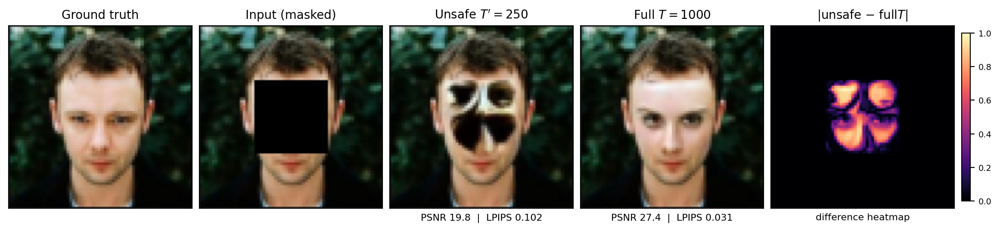
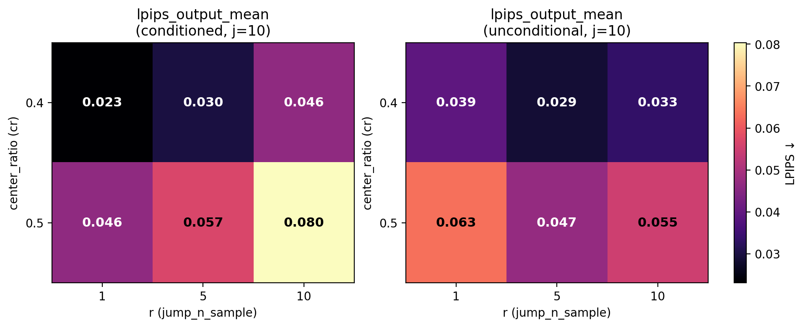

# Diffusion Image Inpainting

This repo is a from-scratch diffusion inpainting stack, and a simple question that came out of using it:

**If RePaint resampling is supposed to make fills look more natural, why does turning it up sometimes make them worse?**

The short answer: it depends how the model was trained. Extra resampling *helps* an unconditional face DDPM and *hurts* a mask-conditioned one on large holes in the middle of the face. The setting that looks best for conditioned models is also the cheapest.

The paper is in [`docs/final_paper.pdf`](docs/final_paper.pdf). Code here trains both models, runs RePaint, and reproduces the paired evaluation.

---

## The problem

Inpainting means filling missing pixels while keeping the known ones. Diffusion models are a natural tool for this, but there are two common recipes:

1. **Unconditional.** Train a normal image DDPM. At test time, RePaint keeps stitching the known pixels back in after each reverse step, and can also jump forward and denoise again (`r` times) so the hole and the context have more chances to agree.
2. **Mask-conditioned.** Train the U-Net to see the noisy image, the known pixels, and the mask on every step (Palette-style concat). The constraint is already inside the network. People still copy RePaint’s `(j, r)` knobs onto this pipeline because “resampling is just inference.”

I wanted to know whether that copy-paste is harmless.

The models themselves are small ε-prediction DDPMs (same U-Net for both regimes) on CelebA at 64×64, plus MNIST / Fashion-MNIST for the earlier pipeline work. The noise schedule and U-Net come from my [`generative-models`](https://github.com/HusseinHanafy207/generative-models) repo; this project adds masks, RePaint, training, and eval.

---

## First: the protocol has to be honest

Before the resampling question is even well-posed, the reverse chain has to match training. Sampling a `T = 1000` checkpoint with a truncated `T' = 250` chain from pure noise looks like a weak model when it is really a broken sampler. On conditioned CelebA center masks that gap was about **+7.6 dB PSNR** once the full schedule was restored.

That is written up in the [technical report](docs/Technical_report.pdf). The CLI here defaults to full `T` and will not run that mismatched truncation unless you pass `--allow-unsafe-timesteps`.

<p align="center">
  
</p>

After that was fixed, large center holes were still the hard case. Sparse brush/holes masks were much easier. That is the setting the rest of the work focuses on.

---

## Then: resampling is not a free upgrade

RePaint’s resampling count `r` is easy to treat as “more is better.” I trained one **conditioned** DDPM and one **unconditional** DDPM, both to epoch 30, and compared them on the same CelebA identities, same center masks, and same random seeds. Jump length stayed at `j = 10`, reverse length at `T = 1000`. The only intentional change was `r`.

On large center holes (`cr = 0.40` and `0.50`, `n = 32`):

| Model | What I compared | What happened |
|---|---|---|
| Conditioned | `r = 10` vs `r = 1` | **Worse** — about **−2.7 dB PSNR**, `p < 10⁻⁶` |
| Unconditional | `r = 5` vs `r = 1` | **Better** — about **+1.6 to +2.2 dB PSNR**, `p < 0.01` |

LPIPS moves the same way. For the conditioned model, `r = 1` is best and quality falls as `r` grows. For the unconditional model, `r = 5` is best (`r = 10` still beats `r = 1`).

<p align="center">
  
</p>

Visually, conditioned fills at `r = 1` are usually coherent; at `r = 10` they look washed out. Unconditional fills at `r = 1` often have blotchy seams; raising `r` cleans the boundary up.

That is not free. At `T = 1000`, `j = 10`, going from `r = 1` to `r = 10` is about **10×** the U-Net calls and wall-clock time (~14 s/image → ~150 s/image). For the conditioned model you pay that cost and get a worse image.

---

## Was it just “more missing pixels”?

A reasonable worry is that any mask with ~40% missing area would show the same conditioned drop. I ran a **brush-mask** control with coverage matched to a `cr = 0.40` center hole, same paired protocol. PSNR barely moved (`+0.30 dB`, CI includes zero, `p = 0.51`). So the harm is not masked pixel count. It shows up on **large contiguous holes**, where resampling has a whole interior to overwrite, not on sparse strokes that still have nearby context.

I also ran RePaint’s own public **unconditional CelebA-HQ** checkpoint (256×256, qualitative only). Higher `r` still helps there. The conditioned-style collapse does not appear, which is evidence this is about *mask conditioning*, not just my 64×64 U-Net.

---

## How I read it

Unconditional RePaint never shows the network a mask. The stitch after each reverse step is how known pixels get enforced, and the extra jumps reopen the hole so that stitch can happen again. That is doing real work the architecture does not otherwise provide.

The conditioned network already sees `(noisy image, known pixels, mask)` on every step. One stitch (`r = 1`) is usually enough. Extra jumps re-noise and rewrite a fill the model had already committed to. On a big center hole that rewrite looks like over-smoothing. On a brush mask there is not much interior to rewrite, which matches the null.

This is an interpretation of the paired ablations, not a proof of the internals. The study is one architecture, one epoch, 64×64 CelebA, and `n = 32`. Whether the same flip holds on coarser schedules or latent inpainting models is open.

**Practical rule from this data:** use moderate `r` for unconditional RePaint; use `r = 1` for mask-conditioned models on large holes (and as a cheap default on sparse masks too). Report `(j, r)` together with how the model was trained.

---

## Using the code

Needs Python 3.10+ and the sibling DDPM package:

```bash
pip install -e /path/to/generative-models
pip install -e ".[dev]"
pip install -e ".[perceptual]"   # LPIPS
pytest -q
```

Configs are in [`configs/`](configs/). Conditioned CelebA is `configs/celeba.yaml`; unconditional is `configs/celeba_unconditional.yaml`.

```bash
# train
python scripts/train.py --config configs/celeba.yaml --epochs 40 --device cuda
python scripts/train_unconditional.py --config configs/celeba_unconditional.yaml --epochs 40 --device cuda

# inpaint (omit --timesteps to keep reverse length = trained T)
python scripts/inpaint.py --config configs/celeba.yaml \
  --checkpoint outputs/celeba/checkpoints/epoch_030.pt \
  --mask-type center --center-ratio 0.4 \
  --jump-length 10 --jump-n-sample 1 \
  --device cuda --seed 42

# unconditional RePaint: add --unconditional and a moderate --jump-n-sample
python scripts/inpaint.py --config configs/celeba_unconditional.yaml \
  --checkpoint outputs/celeba_uncond/checkpoints/epoch_030.pt \
  --unconditional --mask-type center --center-ratio 0.4 \
  --jump-length 10 --jump-n-sample 5

# paired eval
python scripts/evaluate.py --config configs/celeba.yaml \
  --checkpoint outputs/celeba/checkpoints/epoch_030.pt \
  --mask-type center --center-ratio 0.4 \
  --max-samples 32 --jump-length 10 --jump-n-sample 1 --lpips
```

`--jump-length` / `--jump-n-sample` are RePaint `(j, r)`. Leaving `--timesteps` unset is the safe default. `--timesteps 250` without `--allow-unsafe-timesteps` respaces the trained schedule; the unsafe truncated ablation from the technical report needs the explicit override.

Paper numbers, CSVs, and the LPIPS heatmap live in [`Results/`](Results/). Local training dumps go to `outputs/` (gitignored).

---

## Papers

- [**Resampling Is Not Always Better**](docs/final_paper.pdf) — the finding above. IEEE/ICASSP source: [`docs/paper_ieee/`](docs/paper_ieee/).
- [**Inference Protocol Matters**](docs/Technical_report.pdf) — why reverse length has to match training before you trust any `r` sweep.

## License

[MIT](LICENSE).
